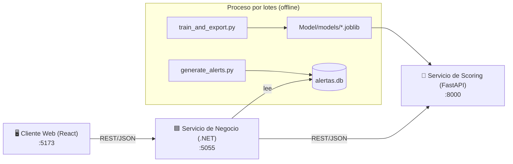

# Arquitectura — Orientada a Servicios (SOA)

Este proyecto adopta una **arquitectura orientada a servicios (SOA)**: la funcionalidad se
divide en **servicios autónomos**, cada uno con una responsabilidad clara y un **contrato
explícito**, que se comunican por la red (HTTP/JSON). Este documento describe los servicios y
**argumenta por qué SOA es la mejor opción** para un sistema de detección de fraude.

---

## 1. Los servicios

| Servicio                            | Tecnología         | Contrato                             | Responsabilidad                                                                              |
| ----------------------------------- | ------------------- | ------------------------------------ | -------------------------------------------------------------------------------------------- |
| **Scoring**                   | Python / FastAPI    | `POST /score`, `GET /health`     | Puntuar una transacción con el modelo. Es una **capacidad reutilizable y sin estado** |
| **Negocio**                   | .NET / ASP.NET Core | `/api/*` (REST)                    | Orquestar: servir alertas, timeline, stats; delegar el scoring                               |
| **Cliente**                   | React / Vite        | consume `/api/*`                   | Presentación e interacción                                                                 |
| **Entrenamiento** *(batch)* | Python              | produce `models/` y `alertas.db` | Generar los artefactos que consumen los servicios online                                     |

Los servicios están **débilmente acoplados**: solo se conocen por su **contrato** (las rutas y
los DTOs), no por su implementación. El cliente no sabe que existe Python; habla solo con el
Servicio de Negocio, que a su vez **delega** el scoring en el Servicio de Scoring.

---

## 2. Por qué SOA es la mejor opción aquí

La detección de fraude es, por naturaleza, una **capacidad de negocio reutilizable**: "dame una
transacción y te digo qué tan sospechosa es". SOA está diseñado exactamente para exponer
capacidades así. En concreto:

1. **Heterogeneidad tecnológica (poliglota).** El modelo vive donde mejor se construye
   (Python/scikit-learn); la lógica de negocio donde conviene a la organización (.NET). SOA
   permite que **cada servicio use la tecnología óptima** sin imponerla a los demás. Un monolito
   obligaría a reescribir el modelo en un solo lenguaje.
2. **Reutilización de la capacidad de scoring.** El Servicio de Scoring **no está atado a esta
   web**: cualquier consumidor (un core bancario, un batch nocturno, otra app) puede invocarlo con
   el mismo contrato. La detección de fraude se vuelve un **servicio compartido**, no una función
   enterrada en una app.
3. **Escalado independiente.** El scoring es la parte cara (CPU, modelo en memoria). Bajo carga se
   pueden levantar **varias instancias solo del Servicio de Scoring** sin tocar el resto. En un
   monolito habría que escalar todo junto.
4. **Despliegue y evolución independientes.** Se puede reentrenar y redeployar el modelo sin tocar
   la API ni la web, siempre que el contrato `POST /score` se mantenga. Los equipos avanzan en
   paralelo.
5. **Aislamiento de fallos (resiliencia).** Si el Servicio de Scoring cae, el de Negocio **degrada
   con elegancia** (responde `503` claro) y el resto del tablero —alertas, timeline— sigue
   funcionando con los datos precalculados. Un fallo no tumba todo el sistema.
6. **Contratos claros y testeables.** Cada frontera es un contrato REST/JSON verificable de forma
   aislada (Swagger/OpenAPI en el Servicio de Negocio). Se puede probar cada servicio por separado.
7. **Separación de cómputo batch y online.** El entrenamiento y la generación de alertas son un
   servicio/proceso **offline**; el scoring es **online**. SOA deja modelar ambos como piezas
   distintas con responsabilidades distintas (una variante ligera de **CQRS**: lectura
   precalculada vs cómputo on-demand).

### Frente a las alternativas

| Opción                               | Por qué NO encaja tan bien                                                                                                                                                        |
| ------------------------------------- | ---------------------------------------------------------------------------------------------------------------------------------------------------------------------------------- |
| **Monolito**                    | Obligaría a un solo lenguaje (reescribir el modelo), acoplaría UI+negocio+modelo, e impediría escalar el scoring por separado                                                   |
| **Microservicios "puros"**      | Para este alcance serían **sobre-ingeniería** (service mesh, registro, despliegue por servicio…). SOA captura los beneficios (servicios con contrato) sin esa complejidad |
| **Función/librería embebida** | El modelo quedaría atado a un solo consumidor y a un solo runtime; se pierde la reutilización                                                                                    |

> **Matiz honesto:** esta es una **SOA ligera**. Captura lo esencial (servicios autónomos con
> contrato, bajo acoplamiento, poliglota, delegación vía proxy), pero aún **no** tiene las piezas
> de una SOA empresarial completa: *API gateway*, *service registry/discovery*, autenticación,
> versionado formal de contratos ni mensajería asíncrona. Ver [§4](#4-cómo-evolucionar-a-una-soa-más-completa).

---

## 3. Contratos y comunicación

- **Protocolo:** HTTP/REST con **JSON**. El Servicio de Negocio fija `camelCase` en el servidor;
  el de Scoring usa los nombres de campo de PaySim (`oldbalanceOrg`, …).
- **DTOs en espejo:** los contratos existen como `record` en C#, `interface` en TypeScript y
  `dict`/`BaseModel` en Python. Un cambio de contrato se refleja en los tres.
- **Delegación (proxy):** el Servicio de Negocio expone `POST /api/score` y **reenvía** al Servicio
  de Scoring, adaptando el formato. Así el cliente tiene **un único backend público**.
- **Descubrimiento:** por configuración (`appsettings.json` → `PythonServiceUrl`), no por un
  registro dinámico (suficiente para este alcance).

---

## 4. Cómo evolucionar a una SOA más completa

**Ya implementado (SOA pragmática):**

- ✅ **Versionado de contratos** (`/api/v1/…` en .NET, `/v1/…` en el scoring).
- ✅ **Autenticación por API key** entre servicios (cabecera `X-API-Key`; el scoring la exige, la
  .NET la valida y la reenvía). Claves DEV por defecto; ver README.
- ✅ **Health checks** (`/health` y `/health/ready` en la .NET; `/v1/health` en el scoring).
- ✅ **Orquestación** con `docker-compose.yml` (un comando levanta los 3 servicios).

**Pendiente (SOA más completa):**

1. **API Gateway** al frente (enrutado, rate-limiting, TLS, auth centralizada).
2. **Autenticación robusta** (OAuth/JWT; hoy es API key de nivel demo — ver
   [NORMATIVAS.md](NORMATIVAS.md), ISO 27001).
3. **Service discovery** (en vez de URLs en configuración).
4. **Mensajería asíncrona** (cola) para scoring de alto volumen en lugar de REST síncrono.
5. **Observabilidad** (trazas distribuidas, métricas por servicio).

---

## 5. Decisiones clave

| Decisión                                      | Motivo                                                                    |
| ---------------------------------------------- | ------------------------------------------------------------------------- |
| Modelo en Python, negocio en .NET              | Cada servicio con su tecnología óptima (poliglota)                      |
| La web habla solo con el Servicio de Negocio   | Un único backend público; el scoring queda interno y reutilizable       |
| Precalcular alertas (SQLite) + scoring en vivo | Tablero instantáneo **y** capacidad de probar transacciones nuevas |
| Delegación por proxy                          | Desacopla al cliente del Servicio de Scoring                              |

Para los **patrones de diseño** concretos dentro de cada servicio, ver
[PATRONES_DISENO.md](PATRONES_DISENO.md).
